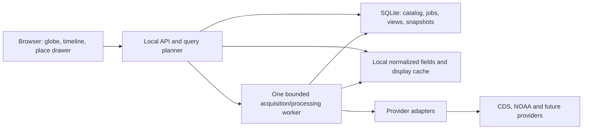

# Architecture and implementation contract

Status: proposed design, pending M1 spikes. See `SPECIFICATION.md` for user requirements and `SCIENCE.md` for numerical rules. No application service is implemented by this skeleton.

## 1. Initial architecture

Use a modular monolith, not microservices. During development, Vite proxies `/api` to the local Python service. A future production-local launcher serves the built browser assets and API from one origin, bound to `127.0.0.1`. Do not open a LAN port by default.

| Area | Proposed choice | Reason / gate |
| --- | --- | --- |
| Browser | React, TypeScript, Vite | Common component and type tooling; pin compatible versions in T-002 |
| Globe | CesiumJS through `MapAdapter` | Geographic raster tiling and polar coverage; prove no paid service dependency and smooth daily playback in T-003 |
| Charts | Select in M2 after accessible chart spike | Do not add a second framework now |
| API | FastAPI and typed request/response models | Validation and generated API documentation; implementation gate |
| Science | xarray, NumPy; format-specific backends | NetCDF first; add GRIB/ecCodes, Zarr, raster tools only when required; verify Windows availability |
| State | SQLite plus ordinary files | Small single-user deployment, migrations and durable job tracking |
| Worker | One separate process, SQLite-backed queue | Avoid blocking requests and losing long provider jobs when an HTTP request ends |
| Cache | Bounded local filesystem, catalogued in SQLite | Reuse work without promising permanent offline retention |

CesiumJS is open source and supports multiple imagery providers ([official overview](https://cesium.com/platform/cesiumjs), [imagery documentation](https://cesium.com/learn/cesiumjs-learn/cesiumjs-imagery/)). Configure an ellipsoid globe with no default ion imagery or terrain request; serve simple context locally. Cesium's [geographic tiling scheme](https://cesium.com/learn/cesiumjs/ref-doc/GeographicTilingScheme.html) covers longitude/latitude, including poles. This is the proposed reason to try it first, not a measured performance conclusion.

MapLibre GL JS is a viable alternative. Its [globe implementation guide](https://github.com/maplibre/maplibre-gl-js/blob/main/developer-guides/globe.md) documents limitations around Mercator-sourced polar data and transitions at high zoom. Revisit it if the Cesium spike is unsatisfactory; do not claim MapLibre lacks a globe.

Use locally packaged Natural Earth context at a recorded version; its [terms](https://www.naturalearthdata.com/about/terms-of-use/) identify those map assets as public domain. It supplies orientation, not weather values or detailed street mapping. Additional basemaps and place search require their own policies and attribution.

## 2. Module boundaries and ownership

- `apps/web/src/map/`: engine-specific globe handling only. Consume prepared layers, point-selection events, and camera state.
- `apps/web/src/features/`: timeline, variable controls, place drawer, source panel, data status, saved views.
- `services/api/src/climaps/`: request validation, query planning, job orchestration, cache and provenance services. Never expose credentials to the browser.
- `packages/contracts/`: versioned scientific and API shapes, examples, and future generated frontend types.
- `packages/science/`: pure unit/calendar/aggregation/coverage operations, introduced with scientific tests during implementation.
- `catalog/`: source definitions and readiness states. Catalog metadata is not executable adapter code.
- `experiments/`: bounded, reproducible spikes and small results. No large archives.
- `data/`: ignored runtime content; initialize subfolders only as needed.

`docs/PSEUDOCODE.md` illustrates workflows. `packages/contracts/adapter.py` and `apps/web/src/map/MapAdapter.ts` are interface sketches. They are not functioning connectors or an installed TypeScript project.

## 3. Three separate data products

1. **Source assets:** provider payload and metadata, version, checksums, retrieval time, and raw time/grid conventions.
2. **Normalized scientific arrays:** masked values and coordinates with explicit quantity, units, bounds, aggregation, quality and lineage. Preserve a path back to source cells.
3. **Display assets:** colored PNG tiles or a geographic overview for a fixed view. These are visualizations, never the numeric sampling source.

For M1a, try two geographic overview images per daily field (one per hemisphere) before building a complex tile pyramid. Bound source-to-image mapping using real cell boundaries. If sufficient, this is a simpler implementation of the same `LayerHandle` contract. If it fails performance or detail targets, use lazy geographic tiles, with maximum level selected from the source grid. Do not prebuild all dates at all zooms.

For geographic XYZ tiles, initial convention is 256x256 pixels, north-origin rows, longitude [-180,180], latitude [-90,90], and level z dimensions `2 * 2**z` by `2**z`. This is not Web Mercator XYZ. Tile bounds are exact fractional partitions of that geographic extent; mapping source samples to pixels must account for center-vs-boundary metadata. Wrap x modulo the level's width; reject out-of-range y and invalid levels. A half-open longitude interval avoids duplicate seam samples.

Display interpolation is recorded independently from point sampling. Query points from native or explicitly identified analysis arrays, not the rendered pixel buffer. If a global overview is coarsened, label that display resolution while retaining native metadata where actually available.

## 4. Canonical concepts

**Dataset descriptor:** provider, product/version, kind, variables and semantics, documented temporal/spatial extent, actual discovered availability, access/license state, quality model, capabilities, verification evidence, adapter readiness.

**Snapshot:** immutable manifest of acquired source assets and transformation version. Includes provider product version, retrieval time, source checksum(s), native metadata, final/provisional status, application commit, adapter version, and any provider request parameters. "ERA5" alone is not an immutable version.

**Variable definition:** physical quantity, height/depth, native units, normalized units, statistic, accumulation interval if any, domain mask, and valid display/aggregation options. `air_temperature_2m` and `sea_surface_temperature` are different identifiers.

**Frame:** supported interval or instant, calendar, display label, source completeness and quality, preparation state, and referenced arrays. A daily frame is not an instantaneous temperature at midnight.

**Query plan:** immutable selection of snapshot(s), variable/statistic, region, time interval/calendar, temporal support, display/analysis grid, units, baseline if any, transformations, palette/range, retention class, and estimated cost. Canonical JSON serialization plus SHA-256 identifies content. Include all scientific and visual parameters; do not hash credentials, tokens, or transient signed URLs. Before source content identities are resolved, use an explicitly labeled draft plan. Preparation produces a distinct immutable execution plan with actual checksums; do not mutate draft identity into an apparently preexisting frozen snapshot. Save/replay the execution plan ID.

**Saved view:** user title plus plan and camera/selection state. It can outlive its cached arrays. Never silently reconstruct an old view using a newly revised source snapshot.

Catalog field `readiness: candidate` means documentation was inspected but retrieval is unproven. `operational` requires a tested adapter, terms review, actual availability discovery, and numerical checks. Display/image-only providers cannot claim point-value capability.

## 5. Provider adapter contract

Capabilities include `scalar_grid`, `point_series`, `station_series`, `vector_grid`, `imagery`, `region_subset`, `temporal_subset`, `daily`, `hourly`, `monthly`, `uncertainty`, and `offline_redistribution`. Distinguish provider-advertised capabilities from those actually implemented and tested.

An adapter performs `discover`, `estimate`, `acquire`, `normalize`, and `health`. Planning invokes only supported operations. Adapters handle provider coordinate and timestamp conventions, availability, rate limits, authentication, and revision policy. Register a source explicitly in code/configuration; never accept an arbitrary browser-supplied URL as a server fetch target.

For CDS, retain external request identifiers when available and poll in the worker. Store the exact request used because daily aggregates are created at retrieval time. Do not assume queue duration or immediate global daily-statistics throughput. Prefer native provider subsetting; if a requested grid is unsupported, estimate native download and local coarsening before fetching.

## 6. API v1 design

All API routes are prefixed `/api/v1`. Dates use half-open intervals `[start,end)` in requests. Initial supported science calendar is Gregorian-compatible historical data; preserve exact native calendar names in responses. Reject unsupported calendar operations rather than silently coercing them. Calendar expansion is a separate capability gate.

| Method / route | Result |
| --- | --- |
| `GET /health` | Local API/worker health and schema version, no secrets |
| `GET /datasets` | Catalog, readiness/access state and capability summaries |
| `GET /datasets/{id}` | Full source descriptor and evidence |
| `GET /datasets/{id}/availability` | Actual published intervals, gaps, provisional dates, discovery timestamp |
| `POST /plans` | Validate request; return cost plus labeled draft plan or immutable plan if inputs are already resolved; no bulk acquisition yet |
| `POST /plans/{id}/prepare` | Enqueue idempotent acquisition after budget checks; return `202` and job ID |
| `GET /jobs/{id}` | State, progress, bytes, provider wait, retry/error, cancellation status and resulting execution plan ID when ready |
| `POST /jobs/{id}/cancel` | Request cancellation; retain reusable complete assets, clean partials safely |
| `GET /plans/{id}/frames` | Frame manifest, intervals, readiness, quality, legend, prepared overview/tile URLs |
| `GET /plans/{id}/frames/{frame}/sample?lat=&lon=` | Native scientific value or explicit missing/not-applicable result, representative cell, units and provenance |
| `GET /plans/{id}/tiles/{frame}/{z}/{x}/{y}.png` | Prepared geographic display tile; maximum level and scheme in frame manifest |
| `POST /series` | Plan/point/interval/statistic request; inline bounded result or `202` for heavier work |
| `GET /provenance/{snapshot_id}` | Lineage, citation and transformation manifest |
| `GET/POST /views` | List or save named view; use `PUT/DELETE /views/{id}` for local editing/deletion |
| `GET /storage` | Quotas, reservations, used/pinned/evictable bytes and free-disk state |
| `POST /storage/evictions` | Explicit cache cleanup by asset ID or safe reclaim target; cannot delete pinned inputs silently |

General errors use `{code,message,retryable,details,request_id}`. Return `400` malformed input, `404` unknown resources, `409` scientific incompatibility or preparation conflict, `422` unsupported selection or excessive range, `429` throttling, `503` transient provider failure, and `507` insufficient storage. Provider login requirements use `409` with `SOURCE_AUTH_REQUIRED`, distinguishing this from authentication to a future public app. Missing data within a valid sampled cell returns `200`, `value: null`, and a status code; it is not a fabricated zero. Unprepared tiles return a typed non-image error; client orchestration uses frame readiness instead of retrying indefinitely.

API shapes are specified here and in contract examples; a full generated OpenAPI schema is an M1 implementation deliverable. Version contract changes explicitly.

## 7. Playback and concurrency

- UI state separates `requestedTime`, `displayedFrame`, and `loadingState`. One generation ID identifies the current selection.
- Seeking aborts irrelevant browser requests and discards late responses from earlier generations. The backend can finish reusable work under its bounded job policy.
- Preload a small adjacent window (proposal: current plus three following and one preceding frame), bounded by bytes rather than count alone. Never load a year of native global hourly arrays into the browser.
- The date and legend change only when the prepared frame is committed. Prefer an atomic overview swap for M1a. A tile implementation must prove coherent required-viewport tile readiness before advancing the date; incomplete tiles remain visibly loading.
- Optional visual crossfade is disabled initially. If later introduced, label it as a display transition and keep numeric values tied to an actual frame.
- Queue jobs by interactive demand before background prefetch. One job can have multiple subscribers. Canceling one subscriber must not cancel data another active view still needs.
- Job states: `queued -> waiting_provider -> downloading -> validating -> normalizing -> ready`; terminal alternatives `failed` or `canceled`. Restart resumes only validated resumable work; otherwise clean/retry with a record.

## 8. Storage and resource budgets

Use decimal GB in user controls and report exact bytes internally. Proposed maximum managed occupancy is 90 GB, leaving 10 GB of the approximate allocation for headroom. Initial soft allocations: raw source assets 25 GB, normalized arrays 35 GB, rendered/cache assets 15 GB, temporary jobs 15 GB. These total 90 GB; they are adjustable shares under one hard cap, not permission to exceed it. Keep at least 5 GB actual filesystem free as an additional stop condition.

Track SQLite, logs, source assets, derived data, tiles, scratch files, and in-flight reservations. Before a job starts, estimate peak footprint including archive extraction and normalization overlap. Atomically reserve budget and recheck free disk; refuse or ask the user to choose a smaller request if the estimate cannot fit. Increase estimates conservatively when provider content length is unknown; stop streaming at bounded byte limits.

Eviction order: unpinned display cache -> reproducible derived cache -> unpinned source assets. Pinning is explicit and reports capacity impact. Never evict the active plan's leased assets, pinned content, manifests needed to explain retained views, or arbitrary files outside the configured data root. Keep provenance after eviction and mark the snapshot's assets unavailable. An eviction transaction updates metadata atomically around safe filesystem changes; startup reconciliation finds abandoned partials.

`tools/estimate_storage.py` models arrays with float32 values and a byte mask. It also models display-frame buffers. Results are calculated estimates, not observed disk use, compression ratios, throughput, or quality guarantees. See `experiments/storage-estimates.json` and `EXPERIMENTS.md`.

## 9. Persistence and revisions

Initial SQLite entities: `datasets`, `availability_checks`, `snapshots`, `assets`, `transforms`, `plans`, `jobs`, `job_subscribers`, `reservations`, `views`, and `schema_migrations`. Use stable IDs and foreign keys; no credentials in rows intended for export. Track checksums and asset paths relative to the managed data root.

Downloads write a unique temporary file, enforce limits, validate payload/metadata/checksum, then publish by atomic rename and manifest transaction. Preserve a previous ready snapshot while a replacement is prepared. Conditional provider requests can avoid redundant transfers; ETag is useful metadata but is not always a cryptographic content checksum. A provider revision creates a new snapshot rather than rewriting history.

Save local preferences separately from scientific snapshot identity. Browser state may use localStorage for harmless UI preferences; data retention and jobs live in the backend. Back up SQLite and manifests before incompatible migrations. Git protects source and specifications, not ignored climate files or database state.

## 10. Security and public-release boundary

For local use, bind to loopback, restrict accepted Host and Origin values, and protect state-changing endpoints from cross-origin browser requests. A packaged launcher can supply a local session token. A future public deployment requires a separate authentication, quota, abuse, cost and redistribution design; exposing the local server is not that design.

Provider URLs come from reviewed adapters and allowlisted hosts. Reject unsafe redirect targets, private/internal destinations, invalid archive member paths, and oversized/unexpected content. Resolve output paths beneath the managed data root. Keep credentials in environment/user configuration, redact logs, and never place them in cache keys or browser bundles. These checks belong in shared acquisition code, not copied inconsistently into each adapter.

Logs use bounded rotation and structured error codes, provider identifiers, plan/job IDs and timings. Do not log access tokens or unnecessarily precise user locations. No cloud upload or telemetry by default.

## 11. Implementation setup gate

In M1: verify Windows wheel/backend availability, select current compatible versions from official documentation, add `package.json`, Python dependency metadata, lockfiles, and a Windows-first launcher. Keep Node/Python compatibility documented. There are intentionally no fabricated install/run commands for an app that does not exist yet.

The xarray [I/O guide](https://docs.xarray.dev/en/stable/user-guide/io.html) documents backend differences across NetCDF, Zarr and other formats; do not assume every format or remote endpoint works without its backend. FastAPI [background-task documentation](https://fastapi.tiangolo.com/tutorial/background-tasks/) distinguishes light request-following work from heavier computation; persistent climate acquisition belongs in the proposed worker, not a fire-and-forget HTTP callback.
